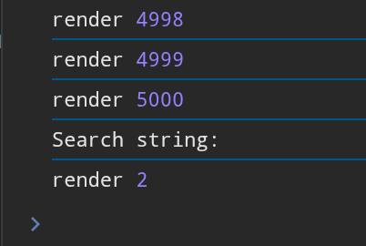

Почему нужен useCallback? У меня и без него работает, но useCallback создает неизменяющуюся ссылку на функцию, ее удобно передавать в props с использованием memo (если пропсы не изменились - нет перерендера), без useCallback анонимные функции по типу () => void пересоздаются => меняют пропс.